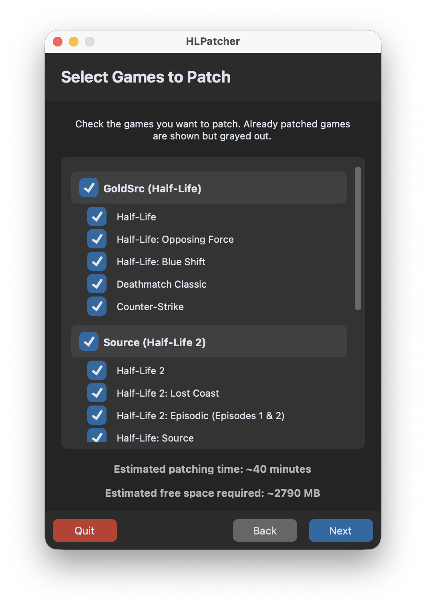

<h1>HLPatcher</h1>

14 games, one patcher

Free, open-source patcher that makes Half-Life, Half-Life 2, Portal, Counter-Strike and other Valve games run natively on Apple Silicon Macs (M1 and newer).

[Get Started](getting-started.md){ .md-button .md-button--primary } [Supported Games](supported-games.md){ .md-button .md-button--secondary }

## Features

-   :material-controller:{ .lg .middle } **From Half-Life to Portal**

    Supports over 10 games, including GoldSrc and Source titles. See the [full list](supported-games.md).

-   :material-chip:{ .lg .middle } **Native on Apple Silicon**

    Your favourite Valve games run natively on Apple Silicon, without any translation layers (Rosetta).

-   :material-cog:{ .lg .middle } **Automated patching**

    Pick your games and HLPatcher downloads, builds and installs everything for you.

-   :material-steam:{ .lg .middle } **Your Steam games**

    Patches the copies you already own, and you keep launching them from Steam.

-   :material-map-marker-path:{ .lg .middle } **Guided steps**

    Shows a step-by-step guide when a game needs an older version.

-   :material-github:{ .lg .middle } **Free and open source**

    No cost, no account, and all the code is publicly available on GitHub.

## Thanks to

-   **Flying with Gauss** for developing [Xash3D FWGS](https://github.com/FWGS/xash3d-fwgs) engine and [HLSDK Portable](https://github.com/FWGS/hlsdk-portable).

    [:fontawesome-solid-globe:](https://xash.su/){ title="Website" aria-label="Website" } [:octicons-mark-github-16:](https://github.com/FWGS){ title="GitHub" aria-label="GitHub" }

-   **Velaron** for developing [Counter-Strike 1.6 reverse-engineered client](https://github.com/Velaron/cs16-client).

    [:octicons-mark-github-16:](https://github.com/Velaron){ title="GitHub" aria-label="GitHub" }

-   **Nillerusr** for developing modifications in the [Source Engine](https://github.com/nillerusr/source-engine) repository.

    [:octicons-mark-github-16:](https://github.com/nillerusr){ title="GitHub" aria-label="GitHub" }

-   **Sethur (Tris)** for [fixing the mouse Y offset issue in fullscreen mode on devices with a camera notch](https://github.com/nillerusr/source-engine/pull/456).

    [:octicons-mark-github-16:](https://github.com/Sethur){ title="GitHub" aria-label="GitHub" }

Without them, HLPatcher wouldn't exist.

## Help Make HLPatcher Better

-   **Contribute**

    Help improve HLPatcher by contributing code or ideas.

    [Contributing Guide](contributing.md){ .md-button .md-button--primary }

-   **Translate**

    Make HLPatcher accessible in your native language.

    [:octicons-link-external-24: Crowdin](https://crowdin.com/project/hlpatcher){ .md-button .md-button--primary }

-   **Support Financially**

    If you enjoy HLPatcher, consider supporting the project.

    [:octicons-link-external-24: Buy Me a Coffee](https://buymeacoffee.com/kacperjar){ .md-button .md-button--primary }

## Copyright Notice

HLPatcher utilizes various third-party patches, modifications and open-source components to function. I respect the intellectual property rights of others.

If you are a copyright owner and believe that any material provided through this project infringes upon your rights, please submit a notification of your claim. You can contact me at [contact@hlpatcher.org](mailto:contact@hlpatcher.org) with the details and any infringing material will be promptly addressed.

---

### Made with ❤️ by Kacper Jarosławski

[:fontawesome-solid-globe: Website](https://kzl21.ovh/) - [:octicons-mark-github-16: GitHub](https://github.com/kacper-jar)

